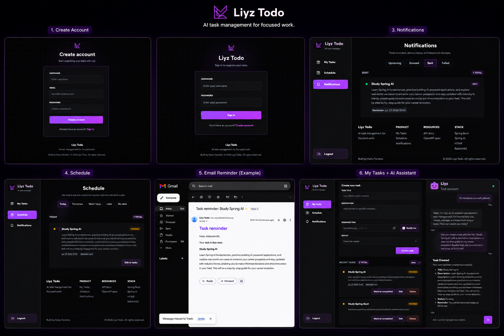

# Liyz Todo

A modern AI-powered task management application built with **Spring Boot**, **Spring AI**, **HTMX**, and **Thymeleaf**.

The project includes **Liyz**, an AI assistant capable of creating, organizing, updating, and managing tasks through natural language. Using conversational memory, tool calling, user-scoped data, and persistent chat history, Liyz can interact with your task list instead of simply generating text.

> **Note:** This project is currently under active development.

---

## Preview

### Web App



### Swagger


---

## Features

- AI-powered task management with Spring AI and tool calling
- HTMX + Thymeleaf web interface
- Spring Security authentication
- User-scoped tasks and chat history
- Conversational memory using Redis
- Persistent AI chat history using PostgreSQL
- CRUD operations for tasks through REST and web UI
- Task reminders with async email notifications
- RabbitMQ-based notification queue
- Resend email integration
- Recurring tasks: daily, weekly, and monthly
- Schedule view with date-based filters
- Notification dashboard for upcoming, queued, sent, and failed reminders
- PostgreSQL database
- Flyway database migrations
- Docker Compose environment for PostgreSQL, Redis, RabbitMQ, and pgAdmin
- RESTful API
- OpenAPI / Swagger documentation
- Modular AI prompt architecture
- Prompt injection protection advisor
- Unit tests for core services

---

## Project Structure

| Directory | Description |
|-----------|-------------|
| `config` | Spring Boot configuration classes. |
| `controller` | REST API endpoints and Thymeleaf view controllers. |
| `dto` | Request and response objects. |
| `entity` | JPA entities. |
| `exception` | Global exception handling using `ProblemDetail`. |
| `prompt` | Prompt loader and AI prompt management. |
| `repository` | Spring Data JPA repositories and Redis chat memory repository. |
| `service` | Business logic implementation. |
| `tools` | Spring AI Tool Calling functions. |
| `resources/db/migration` | Flyway SQL migrations. |
| `resources/prompts` | Modular AI system prompts. |
| `resources/templates` | Thymeleaf pages and reusable fragments. |
| `resources/static` | CSS and frontend assets. |

---

## Available Endpoints

### Task API

| Method | Endpoint | Description |
|--------|----------|-------------|
| GET | `/api/tasks` | Get all tasks |
| POST | `/api/tasks` | Create a new task |
| GET | `/api/tasks/{id}` | Get a task by ID |
| PATCH | `/api/tasks/{id}` | Update task completion status |
| PATCH | `/api/tasks/{id}/details` | Update task title, description, reminder, and recurrence |
| DELETE | `/api/tasks/{id}` | Delete a task |

### AI API

| Method | Endpoint | Description |
|--------|----------|-------------|
| POST | `/ai/chat` | Chat with Liyz using natural language |

### Web Pages

| Page | Description |
|------|-------------|
| `/login` | Login page |
| `/register` | User registration page |
| `/tasks` | Main task dashboard with AI chat |
| `/schedule` | Date-based schedule view |
| `/notifications` | Reminder notification dashboard |

---

## AI Capabilities

Liyz is able to:

- Create tasks from natural language.
- Organize daily and weekly routines.
- Update existing tasks.
- Complete and delete tasks by title or ID when the request is clear.
- Create reminders and recurring tasks.
- Maintain conversational context using Redis.
- Persist chat history using PostgreSQL.
- Call backend tools through Spring AI Tool Calling.
- Respond using Markdown for improved readability.
- Refuse prompt injection attempts that try to reveal hidden instructions or internal tool details.

---

## Technologies

- Java 21
- Spring Boot
- Spring AI
- PostgreSQL
- Redis
- RabbitMQ
- Flyway
- Spring Security
- Thymeleaf
- HTMX
- Bootstrap
- Resend
- Docker / Docker Compose
- Maven
- Swagger / OpenAPI

---

## Getting Started

### Prerequisites

Before running the project, make sure you have:

- Java 21+
- Docker and Docker Compose
- Maven
- An OpenAI or Groq API Key
- A Resend API Key for email notifications

---

### Environment Variables

Copy the example file:

```bash
cp .env.example .env
```

Configure:

- PostgreSQL credentials
- Redis connection
- OpenAI or Groq API Key
- Chat memory settings
- RabbitMQ connection
- Resend email settings
- Notification scheduler settings

For local development outside Docker, use localhost values for PostgreSQL,
Redis, and RabbitMQ according to the ports exposed by Docker Compose.

---

### Running the Project

```bash
git clone https://github.com/ksferreira35/todo-list.git

cd todo-list

docker compose up -d database redis rabbitmq pgadmin

mvn spring-boot:run
```

---

## Roadmap

- [x] CRUD API
- [x] Spring AI Integration
- [x] Spring AI Tool Calling
- [x] Conversational Memory (Redis)
- [x] Persistent Chat History (PostgreSQL)
- [x] Modular Prompt Architecture
- [x] Flyway Database Migrations
- [x] Swagger / OpenAPI Documentation
- [x] Docker Compose
- [x] Unit Tests
- [x] Authentication & Authorization (Spring Security)
- [x] User-scoped tasks and chat conversations
- [x] Due Dates, Reminders & Notifications
- [x] RabbitMQ notification queue
- [x] Resend email notifications
- [x] HTMX + Thymeleaf Frontend
- [x] Recurring Tasks
- [x] Schedule View
- [x] Frontend conversation flow using returned `conversationId`

### Next Features

- [ ] Integration Tests
- [ ] GitOps workflow
- [ ] Kubernetes deployment
- [ ] Vault-based secret management
- [ ] CI/CD pipeline
- [ ] Production observability
- [ ] React or enhanced HTMX frontend iteration

> The roadmap represents the planned core features. The project will continue to evolve with new improvements after these milestones are completed.

---

## License

This project is licensed under the MIT License.

See the [LICENSE](LICENSE) file for more information.
